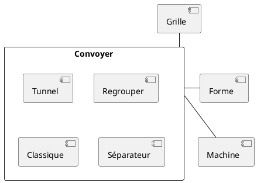
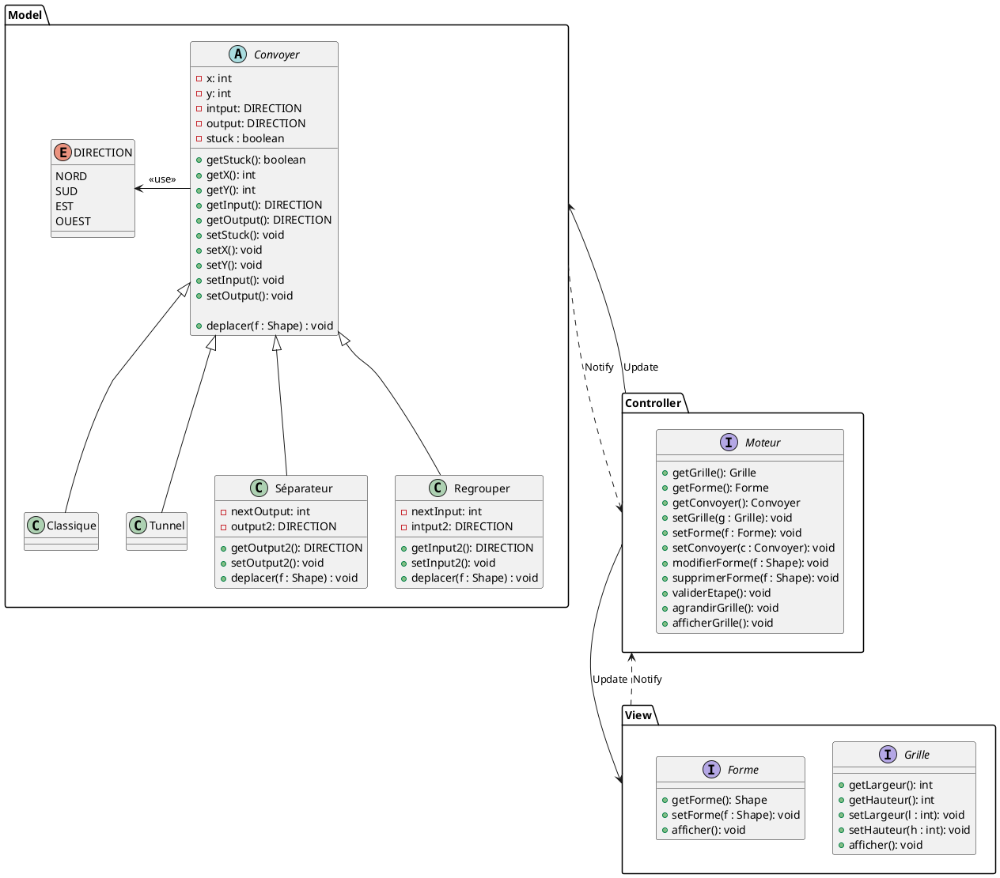
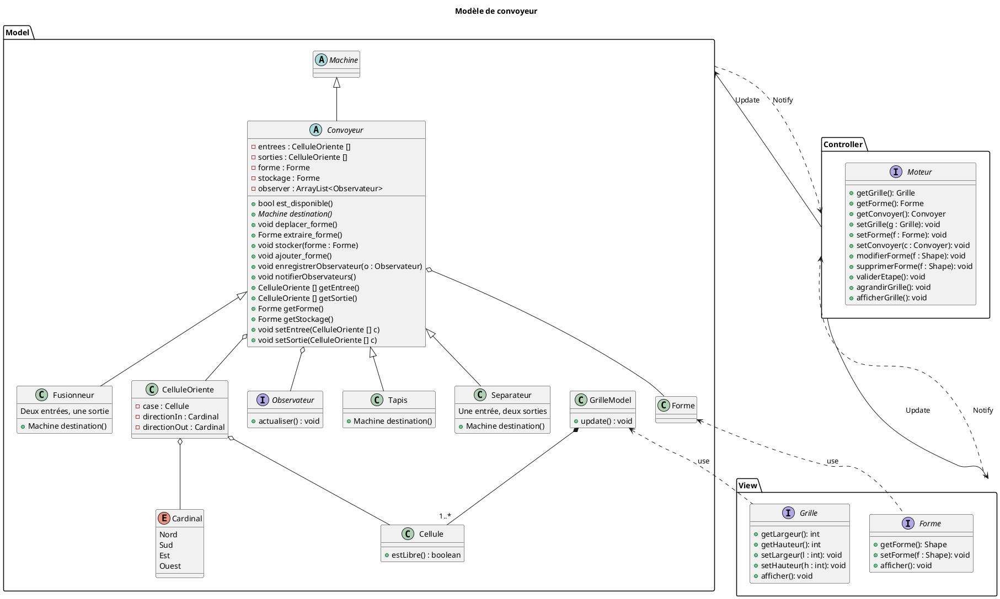

$$
\boxed{
\begin{array}{rl}
\text{CAMBIER} & \text{Louis}  \\
\text{MIRZAEI MEHR}  &  \text{Marzieh} \\
\text{PIQUET}  & \text{Edwyn}  \\
\text{GUILLON} & \text{Florian}  \\
\text{PENUIZIC}  & \text{Yann}
\end{array}} \hspace{200cm}
$$

# Cahier des charges - ShapeZ

# 1. Identification

- Grille :
  - Rôle : Placer un objet
  - Responsabilité : Définir l'emplacement des objet ($x,y$)
  - Données : Positions et entité
  - Interraction : tout objet placable

| Composant | Rôle                                | Responsabilité                                                                                                                                         | Données                                             | Interaction                   |
| --------- | ------------------------------------ | ------------------------------------------------------------------------------------------------------------------------------------------------------- | ---------------------------------------------------- | ----------------------------- |
| Grille    | Placer un objet                      | Définir l'emplacement des objet ($x,y$), fait respecté ses règles de placement (si un objet est placé sur cette grille tu ne peux pas t'y placer) | Positions et entité                                 | tout objet placable           |
| Forme     | Se faire manipuler                   | Rester sur le convoyeur qui la manipule                                                                                                                 | forme / couleur/ rotation/ position                  | Machine et convoyeur          |
| Machines  | Modifier/Créer/Manipuler les formes | Prendre un forme en entrée et ressortir ce qui est demandé sans problème                                                                             | Forme entrée / sortie , orientation, couleur sortie | Avec les formes et convoyeurs |
| Convoyeur | Déplacer les formes                 | Amener les forme d'un point A à un point B sans modification                                                                                           | Forme, sens                                          | Avec tout les composant       |

# 2. Définition des interfaces

- L'interface convoyeur implémente des convoyeur pour déplacer des formes
- L'interface grille implémente un tableau de position pour placer des objets sur la grille
- L'interface forme implémente des formes pour les manipuler
- L'interface moteur gère la logique et l’affichage, et fait le lien entre la grille et les convoyeurs

# 3. Gestion des situation particulières

| Situation particulière                     | Règles d'arbitrage                                                           |
| ------------------------------------------- | ----------------------------------------------------------------------------- |
| blocage d’un convoyeur                     | Arrête le déplacement des formes                                            |
| absence de débouché                       | Il attend et lorsqu'une débouché disponible, il fonce !                     |
| convergence de plusieurs flux               | prend équitablement le flux de ses entrées (envoie de deux flux en un seul) |
| séparation d’un flux                      | sépare équitablement le flux de ses sorties (envoie d'un flux en deux flux) |
| circulation de plusieurs formes successives | Ça ne pose pas de problème tant que le convoyeur n'est pas bloqué          |

# 4. Validation de l'architecture

| ID    | Exigence                                                                                                                                                                              | Composant qui valide le test                            | Test / Justification                                                                                                                        |
| :---- | :------------------------------------------------------------------------------------------------------------------------------------------------------------------------------------ | :------------------------------------------------------ | :------------------------------------------------------------------------------------------------------------------------------------------ |
| F-006 | Le joueur doit pouvoir sélectionner un type d’équipement disponible.                                                                                                               | **Non permis** (pas d'IHM)                        | Pas modélisé dans le diagramme, il manque l'interface graphique et la sélection du joueur.                                               |
| F-007 | Le joueur doit pouvoir orienter les équipements directionnels.                                                                                                                       | **Partiel** (`CelluleOriente`, `Cardinal`)    | Le modèle gère les directions avec `Cardinal`, mais pas la commande du joueur pour changer l'orientation.                               |
| F-008 | Les convoyeurs doivent transporter les formes selon les règles de circulation définies.                                                                                             | **Oui** (`deplacer_forme()`, `destination()`) | Une forme suit la chaîne de convoyeurs selon les directions si la destination est disponible.                                              |
| F-009 | Le système doit gérer les conflits entre plusieurs flux de formes selon des règles d’arbitrage définies.                                                                         | **Partiel** (`Fusionneur`, `Separateur`)      | Les classes existent mais l'alternance équitable entre les flux n'est pas détaillée dans le modèle.                                     |
| F-010 | Le logiciel doit gérer les situations dans lesquelles un équipement ne peut pas poursuivre son opération.                                                                          | **Oui** (`est_disponible()`)                    | Si la destination est pleine ou inexistante, `est_disponible()` renvoie false et la forme reste sur place.                                |
| F-011 | Le système doit préserver le nombre et l’identité des formes lors des transferts entre convoyeurs, hors création ou destruction explicitement autorisée par les règles du jeu. | **Oui** (`extraire_forme()`, `stocker()`)     | La forme est transférée par référence sans copie ni destruction, donc son identité est préservée.                                    |
| F-012 | Un convoyeur ne peut accueillir qu’une seule forme.                                                                                                                                  | **Oui** (`forme`, `stockage`)                 | Le convoyeur n'a qu'un attribut forme et stockage, et `est_disponible()` bloque si c'est déjà plein.                                    |
| F-020 | Les déplacements des formes doivent être calculés selon une règle de mise à jour déterministe, indépendante de l’ordre de parcours des convoyeurs.                            | **Oui** (`GrilleModel.update()`)                | La méthode `update()` en 2 temps (d'abord dans le stockage temporaire, puis validation) garantit que l'ordre de parcours ne change rien. |

| ID    | Exigence                                                                                                                                                 | Module                                     | Vérification                                                                                                                        |
| :---- | :------------------------------------------------------------------------------------------------------------------------------------------------------- | :----------------------------------------- | :----------------------------------------------------------------------------------------------------------------------------------- |
| I-001 | Un convoyeur doit pouvoir accepter un objet forme en entrée.                                                                                            | `stocker()`, `ajouter_forme()`         | Créer un convoyeur vide, lui envoyer une forme et vérifier son contenu.                                                            |
| I-002 | Un convoyeur doit pouvoir fournir la forme qu'il transporte à son équipement de destination lorsque le transfert est autorisé.                        | `deplacer_forme()`, `destination()`    | Créer un convoyeur A avec une forme et B vide en destination, lancer le déplacement et vérifier que B a bien reçu la forme.      |
| I-003 | Un convoyeur doit permettre l'enregistrement d'un ou plusieurs observateurs, qui sont notifiés lorsque son état observable est modifié.               | `observer`, `enregistrerObservateur()` | Enregistrer un observateur sur un convoyeur, ajouter une forme et vérifier que l'observateur est bien notifié du changement.       |
| I-004 | La direction de déplacement d'un convoyeur est définie par une valeur appartenant à l'ensemble {NORD, SUD, EST, OUEST}.                               | `Cardinal`                               | Placer un convoyeur avec pour direction Nord, Sud, Est, Ouest et vérifier que c'est bien pris en compte.                            |
| I-005 | Un convoyeur doit pouvoir déterminer s'il peut recevoir une forme.                                                                                      | `est_disponible()`                       | Appeler `est_disponible()` sur un convoyeur vide (renvoie true) puis plein (renvoie false).                                        |
| I-006 | Un convoyeur doit pouvoir indiquer s'il contient une forme et si celle-ci peut être transférée.                                                       | `getForme()`, `destination()`          | Vérifier si `forme != null` et si la destination est disponible pour le transfert.                                                |
| I-007 | Le système doit permettre de déterminer la destination d'un convoyeur à partir de sa position, de son orientation et de la configuration de la grille | `Tapis.destination()`                    | Créer deux convoyeurs alignés, vérifier que `destination()` renvoie bien le suivant, et renvoie null s'ils ne sont pas en face. |
| I-008 | Le transfert d'une forme doit préserver l'identité et l'état de la forme transférée.                                                                | `Convoyeur`, `Forme`                   | Transférer une forme d'un convoyeur A à B et comparer la référence/ID : les deux doivent être exactement les mêmes.            |

> [!WARNING] Les exigences ci-dessus ont été définies à partir des deux diagrammes fournis (diagramme de classe et séquence de l'update).

## 5. Redéfinition du diagramme de classe

## 6. Précision des test

| Test | Type               | Partie du code                                                                                                                                                       | Exigence Associé                                                    |
| :--- | :----------------- | :------------------------------------------------------------------------------------------------------------------------------------------------------------------- | :------------------------------------------------------------------- |
| 1.   | Test unitaire      | Méthode : `void stocker(forme)`, `void ajouter_forme()`                                                                                                         | F-008, I-001, I-005                                                  |
| 2.   | Test unitaire      | Méthode : `bool est_disponible()`                                                                                                                                 | F-010, F-012, I-005                                                  |
| 3.   | Test intégration  | Méthode : `bool est_disponible()`, `Machine destination()`, `void deplacer_forme()`, `Forme extraire_forme()`, `void stocker()`, `void ajouter_forme()` | F-008, F-011, F-012, F-020, I-001, I-002, I-005, I-006, I-007, I-008 |
| 4.   | Test unitaire      | Méthode : `bool est_disponible()`, `void deplacer_forme()`                                                                                                      | F-008, F-010, F-012, I-005, I-006                                    |
| 5.   | Test intégration  | Méthode : `bool est_disponible()`, `void deplacer_forme()`, `GrilleModel.update()`                                                                            | F-008, F-010, I-002, I-005                                           |
| 6.   | Test intégration  | Méthode : `GrilleModel.update()`, `void deplacer_forme()`, `void ajouter_forme()`                                                                             | F-008, F-012, I-001, I-002, I-005                                    |
| 7.   | Test unitaire      | Méthode : `CelluleOriente`, `Cardinal`, `Tapis.destination()`                                                                                                 | F-007, I-004, I-007                                                  |
| 8.   | Test de robustesse | Méthode : `Tapis.destination()`, `void deplacer_forme()`                                                                                                        | F-008, F-010                                                         |
| 9.   | Test de robustesse | Méthode : `Fusionneur.deplacer_forme()`, `void stocker()`, `GrilleModel.update()`                                                                             | F-008, F-009, F-012                                                  |
| 10.  | Test de robustesse | Méthode : `GrilleModel.update()`, `Forme`                                                                                                                       | F-011, F-012, F-020, I-008                                           |
| 11.  | Test de robustesse | Méthode : `GrilleModel.update()`                                                                                                                                  | F-020                                                                |

1. Réception d’une forme par un convoyeur vide
   Dans le cas d’une réception de forme par un convoyeur vide le test associé est un test unitaire qui utilise la méthode : `void stocker(forme)` puis `void ajouter_forme()`. Exigence associée : F-008, I-001, I-005.
2. Refus de réception d’une forme par un convoyeur qui ne peut pas l’accepter
   Dans le cas du refus de la réception d’une forme par un convoyeur qui ne peut pas l’accepter est testé par un test unitaire sur sa méthode : `bool est_disponible()`. Exigence associée : F-010, F-012, I-005.
3. Transfert d’une forme entre deux convoyeurs compatibles.
   Dans le cas d’un transfert d’une forme entre deux convoyeurs compatibles est testé par un test d’intégration qui utilise les méthodes : `bool est_disponible()`, `Machine destination()`, `void deplacer_forme()`, `Forme extraire_forme()`, `void stocker()` et `void ajouter_forme()`. Exigence associée : F-008, F-011, F-012, F-020, I-001, I-002, I-005, I-006, I-007, I-008.
4. Absence de transfert lorsque la destination est occupée
   Dans le cas d’absence de transfert lorsque la destination est occupée, on fera un test unitaire sur les méthodes : `bool est_disponible()` et `void deplacer_forme()`. Exigence associée : F-008, F-010, F-012, I-005, I-006.
5. Reprise du transfert lorsque la destination redevient disponible
   On teste avec deux convoyeurs A et B. B est bloqué au début puis se libère au tour suivant. On vérifie que `est_disponible()` redevient true et que `deplacer_forme()` effectue le transfert au tour d'après. Exigence associée : F-008, F-010, I-002, I-005.
6. Transport successif de plusieurs formes sur une même ligne de convoyeurs
   On teste une ligne de convoyeurs avec plusieurs formes qui se suivent. On fait plusieurs tours de `GrilleModel.update()` et on vérifie que les formes avancent pas à pas sans jamais être à deux sur le même convoyeur. Exigence associée : F-008, F-012, I-001, I-002, I-005.
7. Changement de direction d’un convoyeur
   On teste un convoyeur avec virage (sortie vers le Sud au lieu de l'Est). On vérifie avec `destination()` que la cellule ciblée change bien et respecte la nouvelle direction. Exigence associée : F-007, I-004, I-007.
8. Gestion d’un convoyeur sans débouché
   On teste un convoyeur qui pointe vers le vide ou une case sans machine. Sa méthode `destination()` renvoie null et `deplacer_forme()` ne transfère rien. La forme reste dessus sans crash. Exigence associée : F-008, F-010.
9. Détection d’un conflit lorsque plusieurs transferts visent une même destination
   Deux convoyeurs envoient vers la même case (fusionneur). On vérifie qu'une seule forme passe à la fois dans le stockage et que l'autre attend son tour. Exigence associée : F-008, F-009, F-012.
10. Vérification de l’absence de perte ou de duplication de formes après plusieurs mises à jour
    On fait tourner la simulation sur plusieurs tours avec plusieurs formes. On compte le nombre de formes au début et à la fin pour vérifier qu'aucune n'a disparu ou été dupliquée. Exigence associée : F-011, F-012, F-020, I-008.
11. Vérification du comportement de la simulation indépendamment de l’ordre de parcours des convoyeurs
    On teste la méthode `GrilleModel.update()` en parcourant les convoyeurs dans l'ordre (1 à N) puis dans l'ordre inverse (N à 1). On vérifie que les deux donnent exactement le même résultat grâce au stockage temporaire. Exigence associée : F-020.

# 7. Planification - Choses restantes à faire

### 1. Code à écrire

- **Classes de base (socle) :**
  - Enum `Cardinal` {Nord, Sud, Est, Ouest}.
  - Classe `Cellule` (coordonnées, machine associée, `estLibre()`).
  - Classe `CelluleOriente` (cellule, directionIn, directionOut).
  - Mock minimal `Forme` (id, couleur, forme) pour valider les transferts.
  - Interface `Observateur` (`actualiser()`).
- **Classes Métier :**
  - Classe abstraite `Convoyeur` (`forme`, `stockage`, `est_disponible()`, `deplacer_forme()`, `extraire_forme()`, `stocker()`, `ajouter_forme()`, observateurs).
  - Classe concrète `Tapis` (1 entrée, 1 sortie, calcul de `destination()`).
  - Classes `Separateur` (1 entrée, 2 sorties) et `Fusionneur` (2 entrées, 1 sortie).
- **Moteur & Grille :**
  - Classe `GrilleModel` (tableau 2D de `Cellule`, méthode `update()` en 2 boucles déterministes).

### 2. Tests à écrire

- **Tests unitaires :**
  - Test unitaire du socle (`Cellule`, `Cardinal`, `CelluleOriente`).
  - Tests unitaires de `Convoyeur` (Test 1 : réception vide, Test 2 : refus plein, Test 4 : destination occupée, Test I-003 : notification observateur).
  - Tests unitaires de `Tapis` (Test 7 : changement de direction / virage).
- **Tests d'intégration :**
  - Test 3 : transfert entre 2 convoyeurs compatibles.
  - Test 5 : reprise du transfert après libération de la destination.
  - Test 6 : transport successif de plusieurs formes sur une chaîne.
- **Tests de robustesse et système :**
  - Test 8 : convoyeur sans débouché (destination nulle).
  - Test 9 : conflit de 2 flux vers une même case (`Fusionneur`).
  - Test 10 : non-perte et non-duplication après $N$ tours de simulation.
  - Test 11 : indépendance de l'ordre de parcours des convoyeurs lors de `update()`.

# 8. Répartition des tâches et planning

> **Règle imposée :** La personne qui écrit le test d'une partie de code n'a pas le droit d'écrire le code correspondant (chaque fichier/classe sera signé).

### Répartition dans l'équipe (5 Rôles)

| Rôle             | Code à implémenter                                                                           | Tests à écrire                                                                          |
| :---------------- | :--------------------------------------------------------------------------------------------- | :---------------------------------------------------------------------------------------- |
| **Rôle 1** | Socle de base (`Cardinal`, `Cellule`, `CelluleOriente`, mock `Forme`, `Observateur`) | Tests système & déterminisme (Tests 10 et 11)                                           |
| **Rôle 2** | Classe abstraite `Convoyeur` (cycle de vie des formes, buffer `stockage`, observateurs)    | Tests unitaires `Tapis` et virages (Test 7) + Tests robustesse sans débouché (Test 8) |
| **Rôle 3** | Classe concrète `Tapis` (gestion 1 entrée / 1 sortie, méthode `destination()`)          | Tests unitaires `Convoyeur` (Tests 1, 2, 4 + observateur I-003)                         |
| **Rôle 4** | Classe `GrilleModel` (matrice de cellules, méthode `update()` en 2 passes)                | Tests d'intégration de flux (Tests 3, 5 et 6)                                            |
| **Rôle 5** | Classes `Separateur` et `Fusionneur` (multi-entrées / sorties)                            | Tests de conflit et arbitrage (Test 9) + Tests unitaires du socle de base                 |

### Planning prévisionnel

- **Séance 1 : Socle et premiers tests unitaires**
  - Rôle 1 code le socle de base ; Rôle 5 écrit les tests du socle.
  - Rôle 3 écrit les tests unitaires de `Convoyeur` ; Rôle 2 implémente `Convoyeur`.
- **Séance 2 : Implémentation du Tapis et de la Grille**
  - Rôle 2 écrit les tests de `Tapis` ; Rôle 3 implémente `Tapis`.
  - Rôle 4 écrit les tests d'intégration (3, 5, 6) ; Rôle 4 et Rôle 2 connectent la grille.
  - Rôle 4 implémente `GrilleModel` et la boucle `update()`.
- **Séance 3 : Robustesse, conflits et déterminisme**
  - Rôle 5 implémente `Separateur` et `Fusionneur` ; Rôle 5/Rôle 4 valident le Test 9.
  - Rôle 1 écrit et passe les tests de non-perte (Test 10) et de déterminisme (Test 11).
- **Séance 4 : Recette finale et intégration**
  - Exécution de toute la suite de tests sur le projet global.
  - Signature des fichiers et validation de la conformité avec le cahier des charges.
